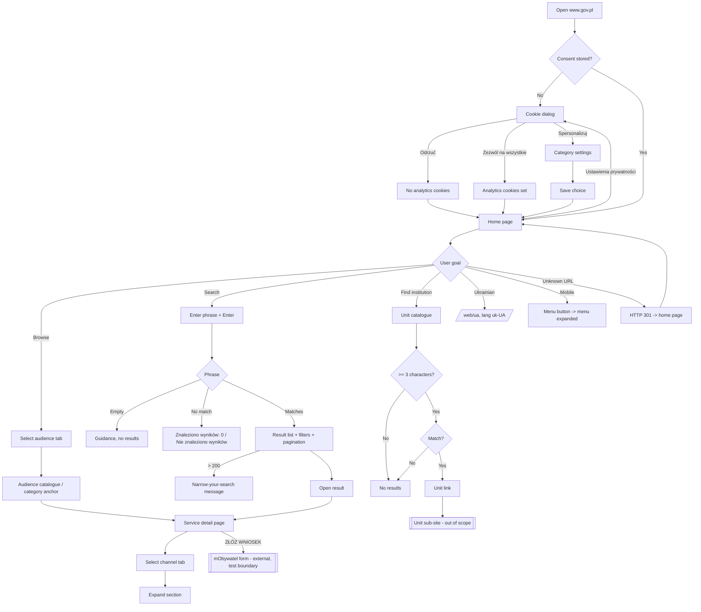

# PRD — GOV.PL Portal (black-box test basis)

> Source: read-only exploration of the live production service `https://www.gov.pl/` on 2026-10-27, performed in a visible Chrome browser through Selenium WebDriver and supplemented with HTTP status checks. No account was used, no form was submitted, and no personal data was entered. This document describes **observed and expected behavior** so that testers can design black-box tests. It is not a specification of a new product and it does not describe the portal's internal implementation.

---

## 1. Executive Summary

GOV.PL is the central web portal of the Polish government. It lets the public find official services, information and public institutions in one place, then hands the user over to transactional systems such as mObywatel to complete a matter online. This PRD defines the scope of the portal that black-box tests should cover: navigation, cookie consent, search, service catalogues, service detail pages, the institution catalogue, the Ukrainian-language service, accessibility basics and the mobile layout. It is a test-basis document for an existing production service (MVP scope of the test suite).

---

## 2. Problem Statement

Government information and e-services in Poland are spread across many ministries, agencies and transactional systems. Without a single entry point, a person who needs to handle an official matter (for example, obtaining an ID card or registering a business) has to:

- know which institution is responsible for the matter,
- find that institution's own website,
- determine whether the matter can be handled online, at an office, or outside an office,
- find the correct application channel and the documents, fees and deadlines that apply.

This is slow and error-prone, especially for people who do not know the structure of the Polish administration, foreigners with limited Polish, and people who use assistive technology. Mistakes lead to unnecessary office visits, rejected applications and missed deadlines.

For testers, the problem is different: the portal has no published requirements document. Tests must be based on observable behavior, and the content changes daily (news, number of search results, service texts).

---

## 3. Users / Personas

### 3.1 Anna — citizen handling an official matter
- 34 years old, lives in Poland, uses a desktop browser and a phone.
- Wants: to find out how to obtain a new ID card, what she must prepare, what it costs, and where to apply (online, at an office or outside an office).
- Expects: to reach the correct service page in a few clicks or through search, to read the requirements grouped by channel, and to be sent to the correct online application form.

### 3.2 Piotr — entrepreneur
- Runs a sole proprietorship.
- Wants: to browse services for businesses (setting up a company, growing it, employing staff, financial support) and find the responsible institution.
- Expects: a business-specific service catalogue reachable from the home page, and a way to find a ministry or public institution by name.

### 3.3 Olena — foreigner / Ukrainian citizen in Poland
- Lives in Poland, reads Ukrainian fluently and Polish partially.
- Wants: information for Ukrainian citizens in Ukrainian, and general services available to foreigners.
- Expects: a clearly marked link to the Ukrainian-language service on every page, and Ukrainian-language content with the correct page language.

### 3.4 Marek — keyboard and screen-reader user
- Blind, uses a screen reader and keyboard only.
- Wants: to perform the same tasks as Anna without a mouse.
- Expects: skip links, a logical focus order, labeled form fields, text alternatives for images, operable tabs and accordions, and a cookie dialog that can be operated from the keyboard.

---

## 4. Main Flows

### 4.1 First visit and cookie consent
1. The user opens `https://www.gov.pl/` with no stored consent.
2. The system displays the home page and a modal cookie dialog titled "Dbamy o Twoją prywatność" with two tabs, "Zgoda" and "Szczegóły", a link to "Polityka cookies", and three buttons: "Odrzuć", "Spersonalizuj" and "Zezwól na wszystkie".
3. The dialog blocks interaction with the page underneath until the user makes a choice.
4. The user chooses one option:
   - **Zezwól na wszystkie**: the system closes the dialog, stores the consent and enables analytics cookies.
   - **Odrzuć**: the system closes the dialog, stores the refusal and does not set analytics cookies.
   - **Spersonalizuj**: the system shows per-category consent settings. The user saves a selection and the dialog closes.
5. On subsequent page loads in the same browser profile, the system does not display the dialog again.
6. The user can reopen the dialog at any time with the "Ustawienia prywatności" button.

### 4.2 Find a service through the home page and catalogue
1. The user opens the home page. The system shows the "Załatwiaj sprawy urzędowe" section with four audience tabs: "DLA OBYWATELA" (selected by default), "DLA PRZEDSIĘBIORCY", "DLA URZĘDNIKA" and "DLA ROLNIKA".
2. The user selects an audience tab. The system marks it as selected and shows the categories for that audience, plus a "ZOBACZ WSZYSTKIE USŁUGI" link to that audience's catalogue.
3. The user selects a category (for example "Dokumenty i dane osobowe"). The system opens the audience catalogue page and scrolls to the matching category section.
4. The user selects a service (for example "Uzyskaj dowód osobisty"). The system opens the service detail page (Flow 4.4).

### 4.3 Find a service through search
1. The user enters a phrase in the header search field ("Szukaj usług, informacji, wiadomości") and presses Enter or clicks "Wyszukaj".
2. The system opens the search results page with the phrase in the URL query parameter `query`.
3. The system displays the "Wyniki wyszukiwania" heading, the number of results ("Znaleziono wyników: N"), a result list (title, date and publishing unit), the "Okres" and "Jednostka administracji" filters, and pagination with a page-size choice of 10, 25 or 50.
4. The user narrows the results with a filter. The system reloads the results automatically, without a separate submit action.
5. The user opens a result. The system navigates to the result page.

**Alternative paths:**
- **No results:** for a phrase with no matches, the system shows "Znaleziono wyników: 0" and "Nie znaleziono wyników".
- **Empty phrase:** the system shows the search page with guidance ("Wpisz jedną frazę lub kilka") and no result count.
- **Over 200 matches:** the system shows "Znaleziono więcej niż 200 wyników. Zawęź listę wyników korzystając z wyszukiwarki."
- **Markup or special characters in the phrase:** the system treats them as text. No script runs and no browser dialog appears.

### 4.4 Read a service detail page and hand off to the application
1. The system shows the breadcrumb, the service name as the page heading, an introduction, optional information notices, and a primary "ZŁÓŻ WNIOSEK" link when an online application exists.
2. The system shows channel tabs: "PRZEZ INTERNET", "W URZĘDZIE" and "POZA URZĘDEM". The first tab is selected by default.
3. The user selects a tab. The system shows the content for that channel only.
4. Each channel shows collapsible sections, all collapsed by default: for example "Kto składa wniosek", "Co musisz przygotować", "Ile zapłacisz", "Ile będziesz czekać" and "Podstawa prawna". The user expands a section and the system shows its content.
5. The page footer area shows "Ostatnia aktualizacja", "Instytucja odpowiedzialna za usługę" and, where relevant, "Instytucja odpowiedzialna za dokument".
6. The user clicks "ZŁÓŻ WNIOSEK". The system navigates to the external application form on the mObywatel domain (`www.mobywatel.gov.pl`). The test boundary ends at this hand-off.

### 4.5 Find a public institution
1. The user opens "Urzędy, instytucje i placówki RP" from the main menu (catalogue of units) or "Ministerstwa".
2. On the unit catalogue, the user types into the field "Znajdź urząd, instytucje lub jednostkę administracji publicznej".
3. After at least 3 characters, the system shows matching units automatically. The catalogue has no search button.
4. The user opens a unit and the system navigates to that unit's page.

**Alternative path:** with fewer than 3 characters, or with a phrase that matches no unit, the system shows no unit results.

### 4.6 Ukrainian-language service
1. The user clicks "Сайт для громадян України – Serwis dla obywateli Ukrainy" in the main menu or the home page promotion.
2. The system opens `https://www.gov.pl/web/ua` with Ukrainian content and the page language set to `uk-UA`.
3. The short address `https://www.gov.pl/ua` leads to the same page.

### 4.7 Navigation, mobile layout and keyboard access
1. On a desktop viewport, the system shows the main menu as a side navigation: Strona główna, Rada Ministrów, Kancelaria Premiera, Ministerstwa, Urzędy, instytucje i placówki RP, the four audience service catalogues, Profil zaufany, Baza wiedzy, Serwis Służby Cywilnej and the Ukrainian service.
2. On a narrow (phone-width) viewport, the main menu is hidden behind a menu button ("Menu główne GOV. Pokaż nawigację."). Activating the button opens the menu and sets its expanded state to true. Activating it again closes the menu.
3. Pressing Tab once from the top of the home page moves focus to the "Przejdź do sekcji Aktualności" skip link.
4. The footer shows: Polityka cookies, Służba cywilna, Profil zaufany, BIP, Prawa autorskie, Warunki korzystania, Geoportal and Deklaracja dostępności serwisu Gov.pl.

### 4.8 Unknown address
1. The user opens an address under `https://www.gov.pl/web/...` that does not exist.
2. The system responds with HTTP 301 and redirects to `https://www.gov.pl/`. No "page not found" page is shown. This is observed behavior. See Section 12.

---

## 5. User Stories

1. As Anna, I want to find "Uzyskaj dowód osobisty" through the citizen catalogue, so that I can learn how to obtain an ID card without knowing which ministry is responsible.
2. As Anna, I want to see requirements separately for online, at-office and outside-office channels, so that I prepare only what my chosen channel needs.
3. As Anna, I want "ZŁÓŻ WNIOSEK" to take me directly to the correct online form, so that I do not have to search for the application again.
4. As Anna, I want a clear "no results" message when my search phrase matches nothing, so that I know to rephrase instead of waiting.
5. As Piotr, I want a services catalogue for entrepreneurs reachable from the home page, so that I see only matters relevant to my business.
6. As Piotr, I want to find a public institution by typing part of its name, so that I can reach its page without browsing the full list.
7. As Olena, I want to switch to a Ukrainian-language service, so that I can understand information that affects my stay in Poland.
8. As Marek, I want to skip repeated navigation and operate tabs, accordions and the cookie dialog with the keyboard, so that I can complete the same tasks as a mouse user.
9. As any user, I want to refuse analytics cookies and not be asked again on every page, so that my privacy choice is respected and the site stays usable.
10. As any user on a phone, I want a collapsible main menu, so that content is readable without horizontal scrolling.
11. As any user who opens an outdated link, I want to land on a working page instead of an error, so that I can continue navigating. (Observed redirect behavior. See Section 12.)

---

## 6. Acceptance Criteria

All criteria apply to the live production service, are read-only, and must not depend on exact news content or exact result counts unless stated.

### Cookie consent
- **AC-01:** In a browser profile with no stored consent, loading `https://www.gov.pl/` displays a dialog headed "Dbamy o Twoją prywatność" with the buttons "Odrzuć", "Spersonalizuj" and "Zezwól na wszystkie" and the tabs "Zgoda" and "Szczegóły".
- **AC-02:** While the consent dialog is displayed, the header search field cannot receive typed input from a user interaction.
- **AC-03:** After "Odrzuć" is clicked, the dialog is no longer visible and the browser holds no analytics (`_pk_*`) cookies for `www.gov.pl`.
- **AC-04:** After "Zezwól na wszystkie" is clicked, the dialog is no longer visible and analytics (`_pk_*`) cookies are present.
- **AC-05:** After either choice, reloading the page in the same profile does not display the dialog.
- **AC-06:** Clicking "Ustawienia prywatności" after a choice has been made displays the consent dialog again.
- **AC-07:** The "Polityka cookies" link in the dialog and in the footer opens `/web/gov/polityka-dotyczaca-cookies`.

### Home page and navigation
- **AC-08:** The home page title is "Portal Gov.pl" and the `html` element has `lang="pl-PL"`.
- **AC-09:** The main menu (navigation labeled "Menu główne") contains links for Ministerstwa, Urzędy, instytucje i placówki RP, Usługi dla obywatela, Usługi dla przedsiębiorcy, Usługi dla urzędnika, Usługi dla rolnika, Profil zaufany, Baza wiedzy and the Ukrainian service.
- **AC-10:** Each link in the main menu and footer returns a final HTTP status of 200 after redirects.
- **AC-11:** On the home page, "DLA OBYWATELA" is selected by default (`aria-selected="true"`).
- **AC-12:** Selecting any of the four audience tabs sets it to `aria-selected="true"`, sets the other three to `false`, and shows a "ZOBACZ WSZYSTKIE USŁUGI" link to `/web/gov/uslugi-dla-obywatela`, `/web/gov/uslugi-dla-przedsiebiorcy`, `/web/gov/uslugi-dla-urzednika` or `/web/gov/uslugi-dla-rolnika` respectively.
- **AC-13:** The "mObywatel" header link points to `https://www.mobywatel.gov.pl/mObywatel`.

### Service catalogues
- **AC-14:** Each audience catalogue page has a level-2 heading equal to its audience name (for example "Usługi dla obywatela") and at least one category heading with at least one service link.
- **AC-15:** The citizen catalogue contains these category headings: Dokumenty i dane osobowe, Edukacja, Kierowcy i pojazdy, Meldunek i wybory, Nieruchomości i środowisko, Podatki, Pomoc prawna, Praca i biznes, Rodzina i małżeństwo, Wojsko i bezpieczeństwo, Wyjazdy i wypoczynek, Dotacje i pomoc finansowa, Zaświadczenia i odpisy, Zdrowie i ubezpieczenia społeczne, Cudzoziemiec w Polsce.
- **AC-16:** Opening a citizen catalogue URL with a category fragment (for example `#kierowcy-i-pojazdy`) scrolls the page so that the matching category is not at the top of the document (vertical scroll position > 0).
- **AC-17:** Clicking a category on the home page "DLA OBYWATELA" panel navigates to the citizen catalogue with the matching category fragment.

### Search
- **AC-18:** Submitting phrase X from the header search field navigates to `/web/gov/szukaj?query=<URL-encoded X>` and displays the heading "Wyniki wyszukiwania".
- **AC-19:** For a phrase with at least one match (for example "paszport"), the page displays "Znaleziono wyników:" followed by a number greater than 0 and at least one result item with a title, a date in `DD.MM.YYYY` format and a publishing unit name.
- **AC-20:** For a phrase with no matches (for example "qzxqzxqzx123"), the page displays "Znaleziono wyników: 0" and "Nie znaleziono wyników".
- **AC-21:** For an empty phrase, the page displays "Wpisz jedną frazę lub kilka" and no result items.
- **AC-22:** When the result count is greater than 200, the page displays "Znaleziono więcej niż 200 wyników".
- **AC-23:** The "Okres" filter offers exactly these options: Ostatnie 7 dni, Ostatnie 30 dni, Ostatnie 90 dni, Ostatni rok.
- **AC-24:** Results offer page sizes 10, 25 and 50, and "Poprzednia strona wyników" / "Następna strona wyników" controls.
- **AC-25:** Submitting `` as a phrase opens no browser alert dialog and does not execute the script.
- **AC-26:** The search results page keeps the submitted phrase in its own search field.

### Service detail page (reference page: "Uzyskaj dowód osobisty")
- **AC-27:** `https://www.gov.pl/web/gov/uzyskaj-dowod-osobisty` returns HTTP 200 and has the title "Uzyskaj dowód osobisty - Gov.pl - Portal Gov.pl".
- **AC-28:** The breadcrumb contains a home link and "Gov.pl".
- **AC-29:** The page shows three tabs, "PRZEZ INTERNET", "W URZĘDZIE" and "POZA URZĘDEM", with "PRZEZ INTERNET" selected on load.
- **AC-30:** Selecting a tab sets it to `aria-selected="true"`, sets the other tabs to `false`, and shows only that tab's sections.
- **AC-31:** Every collapsible section in the visible tab has `aria-expanded="false"` on load. Activating one changes it to `true` and shows its content.
- **AC-32:** The "ZŁÓŻ WNIOSEK" link points to a URL on host `www.mobywatel.gov.pl`. For the reference page, its path and query are `/form-viewer/?name=wniosek-o-wydanie-dowodu-osobistego`.
- **AC-33:** The page shows "Ostatnia aktualizacja:" followed by a date and time, and "Instytucja odpowiedzialna za usługę:" followed by an institution name.

### Institution catalogue
- **AC-34:** `/web/gov/katalog-jednostek` shows a text field labeled "Znajdź urząd, instytucje lub jednostkę administracji publicznej" and the instruction "Wpisz minimum 3 znaki aby rozpocząć wyszukiwanie".
- **AC-35:** Typing "cyfryzacji" shows a result linking to "Ministerstwo Cyfryzacji" without pressing Enter or any button.
- **AC-36:** Typing a phrase that matches no unit (for example "qzxqzx") shows no unit result links.
- **AC-37:** `/web/gov/ministerstwa` returns HTTP 200 and shows the heading "Ministerstwa".

### Ukrainian-language service
- **AC-38:** `https://www.gov.pl/web/ua` returns HTTP 200, `html` has `lang="uk-UA"`, and the first heading is "Сайт для громадян України".
- **AC-39:** `https://www.gov.pl/ua` ends at `https://www.gov.pl/web/ua`.
- **AC-40:** The main menu link to the Ukrainian service is present on the home page, the citizen catalogue and the reference service detail page.

### Accessibility basics
- **AC-41:** On the home page, the first Tab key press from the top of the document focuses the link "Przejdź do sekcji Aktualności".
- **AC-42:** Activating the skip link "Przejdź do sekcji Stopka gov.pl" moves focus or scroll position to the footer link section (`#footer-links`).
- **AC-43:** Every `img` element on the home page, citizen catalogue and reference service detail page has an `alt` attribute.
- **AC-44:** The header search field has an accessible name and the "Wyszukaj" button has visible text.
- **AC-45:** The consent dialog buttons, audience tabs, service detail tabs and collapsible sections can be activated with the keyboard (Enter or Space) and produce the same result as a mouse click.
- **AC-46:** The footer contains a "Deklaracja dostępności serwisu Gov.pl" link that opens a page with that heading.

### Mobile / responsive layout (390 × 844 viewport)
- **AC-47:** The menu button with accessible name "Menu główne GOV. Pokaż nawigację." is visible and has `aria-expanded="false"` on load.
- **AC-48:** Activating the menu button sets `aria-expanded="true"` and makes the main menu links visible within the viewport.
- **AC-49:** The home page, citizen catalogue and reference service detail page have no horizontal scrollbar (document scroll width ≤ viewport width).
- **AC-50:** The header search field is visible and usable on the home page.

### Unknown addresses
- **AC-51:** A request to a non-existent path under `/web/` (for example `/web/gov/nie-istnieje-abc`) returns HTTP 301 with `Location: https://www.gov.pl/`, and the browser ends on the home page. (Observed behavior. See Section 12.)

---

## 7. Out of Scope

- **Authentication and transactional systems:** no login to mObywatel, Profil zaufany, e-Doręczenia, ePUAP or any other system. Tests verify hand-off link targets only.
- **Submitting applications or forms with data:** no "ZŁÓŻ WNIOSEK" form is opened beyond confirming its target URL. No personal data is entered anywhere.
- **Baza wiedzy (knowledge base) content:** only its link presence in the main menu is in scope.
- **Ministry and unit sub-sites:** content and behavior inside `/web/<unit>` sites other than `/web/gov`, `/web/ua` and the catalogue pages.
- **BIP, Geoportal, Serwis Służby Cywilnej and other linked services:** only the link presence and final HTTP status are in scope.
- **Content correctness:** legal accuracy of service texts, fees, deadlines and news articles.
- **Search relevance ranking:** recorded as an open question, not an acceptance criterion.
- **Exact counts and news items:** number of search results, number of services and specific news headlines.
- **Performance, load and security testing:** no load, stress, penetration or vulnerability scanning against production.
- **Full WCAG audit:** only the accessibility basics in Section 6 are covered.
- **Native mobile apps:** the mObywatel app and other apps. Only the responsive website in a browser is covered.
- **Languages other than Polish and Ukrainian:** for example, an English version.
- **Administrative / CMS functions:** content publishing, editor accounts and back office.
- **Notifications and email.**

---

## 8. Constraints

### Business
- The service is a live production system of the Polish government. Testing must be read-only and low-volume. Do not run high-frequency or parallel request bursts.
- No real personal data (PESEL, names, document numbers) may be entered anywhere.
- No login with real or test identities. Transactional systems are external and out of scope.
- Use of the portal is governed by the "Warunki korzystania" and "Polityka cookies" pages linked in the footer.

### Functional
- **Language:** the main service is in Polish (`pl-PL`). The Ukrainian service is in Ukrainian (`uk-UA`).
- **Content volatility:** news, banners, notices and search result counts change without notice. Acceptance criteria rely on structure, labels and behavior.
- **Consent state:** the cookie dialog appears in every fresh browser profile and must be handled before interacting with the page.
- **Institution catalogue:** search starts after a minimum of 3 characters and has no submit button.
- **Search:** results above 200 trigger a "narrow your search" message. Page sizes are 10, 25 and 50.
- **Viewports:** desktop reference 1366 × 900. Mobile reference 390 × 844.
- **Browsers:** current stable Chrome and Edge on Windows were observed. Support for other browsers is not stated by the portal (open question).

### External references

| Document | Location | When it is used |
|---|---|---|
| Polityka cookies | `https://www.gov.pl/web/gov/polityka-dotyczaca-cookies` | Expected consent behavior |
| Warunki korzystania | `https://www.gov.pl/web/gov/warunki-korzystania` | Permitted use of the portal |
| Deklaracja dostępności serwisu Gov.pl | `https://www.gov.pl/web/gov/deklaracja-dostepnosci-serwisu-govpl` | Declared accessibility status and known exceptions |
| Reference service page | `https://www.gov.pl/web/gov/uzyskaj-dowod-osobisty` | Service detail and hand-off criteria |

---

## 9. UI Description (wireframe level)

### 9.1 Global layout (all `/web/gov` pages)
- **Header:** menu button, gov.pl logo (link to home), "Serwis Rzeczypospolitej Polskiej", "mObywatel" login link, EU logo.
- **Left side navigation (desktop) or collapsible menu (mobile):** main menu links listed in Flow 4.7.
- **Skip links:** "Przejdź do sekcji Aktualności" (home only) and "Przejdź do sekcji Stopka gov.pl".
- **Footer:** links listed in Flow 4.7, plus the "Ustawienia prywatności" button.
- **Cookie dialog:** a modal over the page with the "Zgoda" / "Szczegóły" tabs, explanatory text, a "Polityka cookies" link, and the "Odrzuć" / "Spersonalizuj" / "Zezwól na wszystkie" buttons.

### 9.2 Home page
- A promotional banner (for example "Poradnik bezpieczeństwa").
- A carousel of highlighted topics with "Dowiedz się więcej" links and pagination dots.
- "Załatwiaj sprawy urzędowe" with four audience tabs. Each tab panel lists categories with short descriptions and "ZOBACZ WSZYSTKIE USŁUGI".
- An information notice box (content varies).
- "Aktualności": news list.
- "Ważne tematy": topic links.

### 9.3 Service catalogue page
- Breadcrumb, page heading with the audience name, and category sections, each with a heading and a list of service links.
- An empty state was not observed. Every category observed contained links.

### 9.4 Search results page
- Search field ("Wpisz czego szukasz"), clear button ("Wyczyść pole edycyjne / szukaną frazę") and search button.
- Filters: "Okres" (single choice) and "Jednostka administracji" (multi-choice). Changing a filter reloads the results automatically.
- Result count line, result list (title link, date / publishing unit, excerpt) and pagination with a page-size choice.
- **Empty states:** "Nie znaleziono wyników" when there are no matches. Guidance text when the phrase is empty.
- **Over-limit state:** "Znaleziono więcej niż 200 wyników…".

### 9.5 Service detail page
- Breadcrumb, page heading, introduction, optional information notice box, and the "ZŁÓŻ WNIOSEK" primary link (only when online submission exists).
- Channel tabs (PRZEZ INTERNET / W URZĘDZIE / POZA URZĘDEM). Each tab has introductory text and collapsible sections (collapsed by default).
- Metadata: last update date and time, and the responsible institutions.

### 9.6 Institution catalogue page
- Heading "Urzędy, instytucje i placówki RP", a search field with a clear button and instruction text, and a live result list below the field.
- **Empty state:** no result links. No dedicated "no results" text was observed (open question).

### 9.7 Ukrainian service page
- Ukrainian headings ("Сайт для громадян України", "Перші кроки", "Важлива інформація", "Новини", …) inside the same global layout.

### 9.8 Mobile layout
- The side navigation is replaced by the menu button. The header search remains visible. Content is a single column.

---

## 10. User Flow Diagram

---

## 11. Agent / System Behavior Specification

Not applicable. The in-scope portal has no AI agent, chatbot or automated decision function.

---

## 12. Further Notes

### Open questions
1. **Unknown URLs:** non-existent paths return HTTP 301 to the home page instead of a 404 page. Is this intended? It hides broken links from users and search engines. AC-51 records the current behavior. A product owner must confirm the expected behavior.
2. **Search relevance:** the phrase "dowód osobisty" returned thousands of results (9,815 on 2026-10-27), and the first results were unrelated services (for example "Sprawdź normę EURO"). The ID-card service pages appeared lower. The expected relevance (for example, "the matching service page appears in the top 5") is not defined, so it is not an acceptance criterion.
3. **Personalize consent after reopening:** after "Ustawienia prywatności" reopened the dialog, the "Spersonalizuj" button was present but not visible in the observed state. Confirm the expected content of the reopened dialog.
4. **Mobile menu close control:** after the mobile menu opened, the close button "Zamknij menu GOV.pl" was not visible in the viewport. Confirm how the menu is expected to close (the same toggle, the close button, or Escape).
5. **Institution catalogue empty state:** no "no results" message was observed for a phrase that matches nothing. Confirm whether a message is expected.
6. **Supported browsers and devices:** not stated publicly. Confirm the browser and device matrix.
7. **Duplicate sections in hidden tabs:** service detail pages render the same section headings for every channel tab, but only the active tab's sections can be operated. Tests must target the visible tab.

### Assumptions
- Acceptance criteria AC-10, AC-17, AC-26, AC-40, AC-42, AC-45, AC-46 (page heading), AC-48 (link visibility part) and AC-49 describe expected behavior. The exploration session did not verify them. All other criteria match behavior observed on 2026-10-27.
- Observations reflect production on 2026-10-27 in Chrome 156 on Windows 11, Polish locale.
- The reference service page "Uzyskaj dowód osobisty" is representative of service detail pages. Other services may omit "ZŁÓŻ WNIOSEK" or some tabs.
- The banner on the home page about restoring Biuletyn Informacji Publicznej (BIP) is temporary content and is not part of any criterion.

### Deferred to ADR
- Test automation stack and project structure, browser/driver management, consent-handling strategy, locator strategy, test data, reporting and run frequency against production.
